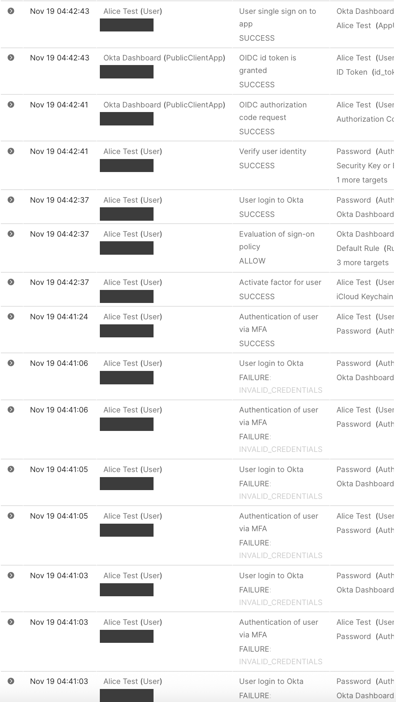
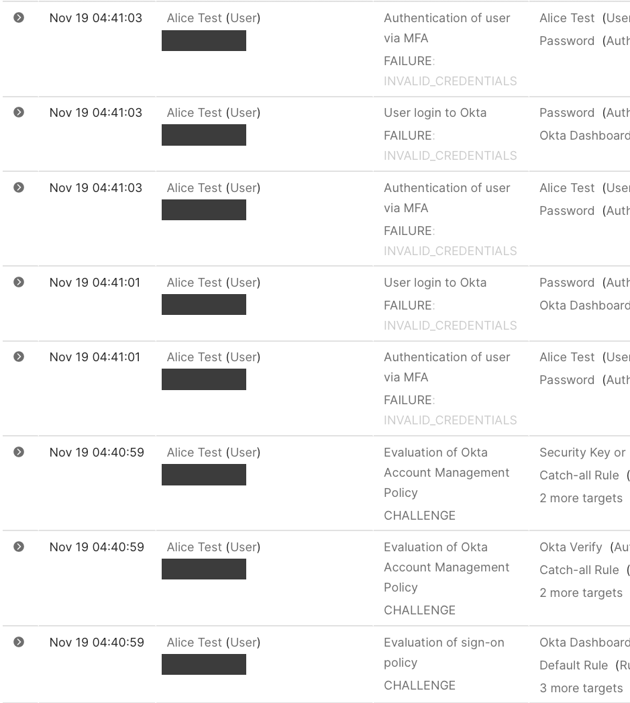
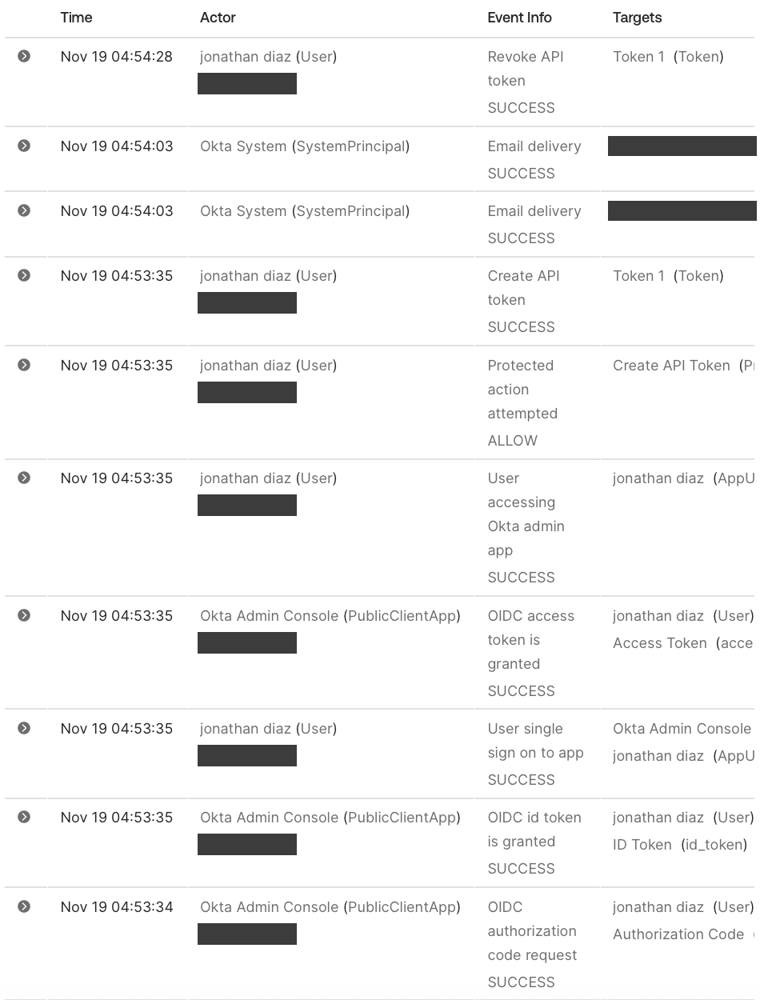

# Okta Account Takeover Indicators: Lab Write-Up

**Author:** Jonathan Diaz | **Date:** Nov 19, 2026 | **Environment:** Okta Integrator Free tenant (6 test users, 1 bookmark app)

**Purpose:** Simulate common identity-attack activity against a lab Okta tenant, locate each event in the System Log, and write detections mapped to MITRE ATT&CK. All activity is a lab simulation run from my own machine (a single source IP; redacted in the screenshots). It is not a real incident.

---

## 1. What I simulated and what the log showed

| # | Scenario | Target | Key log evidence (System Log) |
|---|---|---|---|
| 1 | Password guessing, then lockout | Elise | About 9 failed password attempts in ~10 s (04:29:23–04:29:32), each logged as `user.authentication.auth_via_mfa` FAILURE: INVALID_CREDENTIALS plus a failed "User login to Okta." "Max sign in attempts exceeded" (LOCKED_OUT) at 04:29:34. Further attempts at 04:30:05–04:30:31 all fail with LOCKED_OUT. Admin unlocked the account afterward. |
| 2 | Failed logins followed by a success | Alice | 5 failed password attempts in ~5 s (04:41:01–04:41:06), each logged as an `auth_via_mfa` FAILURE: INVALID_CREDENTIALS plus a failed "User login to Okta." The password then succeeded at 04:41:24, 18 s after the last failure. A passkey was enrolled ("Activate factor for user," iCloud Keychain) at 04:42:37, the sign-on policy returned ALLOW, and the dashboard session started at 04:42:43. No lockout was triggered. |
| 3 | New MFA factor, then admin reset | Dave | 04:47:36 Okta Verify enrolled ("Activate factor for user," SUCCESS). 04:49:11 admin removed the device and reset factors. 04:49:27 Dave's sessions and tokens revoked. 04:49:31 next sign-on challenged. |
| 4 | Admin role grant | Carol | 04:14:03 "Grant user privilege: Super Organization Administrator" performed by the admin account. |
| 5 | API token creation | Admin | 04:53:26 "Protected action attempted" CHALLENGE (step-up). 04:53:34 passkey verification SUCCESS. 04:53:35 "Create API token" SUCCESS. 04:54:28 "Revoke API token" SUCCESS. |

Display names above are copied from the log. Expand each event in the System Log to confirm its `eventType` before using it in a query. Confirmed so far: `user.authentication.auth_via_mfa`.

---

## 2. Detections

| ID | Detection | Logic | ATT&CK | Severity |
|---|---|---|---|---|
| D1 | Brute force / password guessing | 5 or more `auth_via_mfa` failures (INVALID_CREDENTIALS) for one user and one IP within 60 s | T1110.001 | Medium |
| D2 | Account lockout | Any "Max sign in attempts exceeded" (LOCKED_OUT) event | T1110 | Medium |
| D3 | Attempts continuing after lock | LOCKED_OUT login failures continuing after the lock event | T1110 | High |
| D4 | Success after failures | A successful login for a user from the same IP within 15 min of D1 firing | T1078 (Valid Accounts) | **Critical** |
| D5 | New MFA factor or factor reset | A factor activation or an admin-initiated factor reset | T1098.005 (Device Registration) | High |
| D6 | Admin role granted | Any privilege grant to a user, especially Super Admin | T1098.003 (Additional Cloud Roles) | High |
| D7 | API token created | Any API token create event | T1098.001 (Additional Cloud Credentials) | High |

Not covered in this lab: MFA push fatigue (T1621), impossible travel, and password spraying across many users. These need a push-capable factor, multiple source locations, and more accounts.

---

## 3. Triage steps (analyst response)

1. **Scope:** filter the System Log by user and source IP for the last 24 h. Identify every account touched by that IP.
2. **Confirm outcome:** did any login succeed after the failures (D4)? If yes, treat the account as compromised.
3. **Contain:** clear the user's sessions, reset the password, and reset **all** authenticators.
4. **Hunt for persistence:** check for new factors (D5), new admin roles (D6), new API tokens (D7), and new app assignments.
5. **Document:** record timeline, source IP, affected accounts, and actions taken.

---

## 4. Findings and lessons learned

- **A partial MFA reset leaves a back door.** After I reset Dave's Okta Verify, his **passkey (iCloud Keychain) still authenticated** at 04:49:56. In a real incident, all authenticators must be reset, not only the one the attacker used.
- **Source-IP check:** Admin Console token and SSO events at 04:53:35 came from a different IP than the rest of the session. I assume this is a server-side token exchange but did not verify it. Unexplained IP changes inside one session are worth checking.
- **Step-up on sensitive actions works:** creating an API token triggered a "Protected action" challenge and a passkey verification before it was allowed.
- **Lab limitation:** one source IP and my own device, so no geo or travel anomalies.

---

## 5. Next steps

- Add a push-capable factor and simulate MFA fatigue (T1621).
- Forward System Log events to a SIEM (Splunk or Wazuh) and implement D1–D7 as real alert rules.
- Add a behavior-detection and network-zone policy and test impossible travel.

---

## 6. Evidence (System Log screenshots)

Cropped to the relevant rows. Source IPs are redacted.

**Alice: 5 failed logins, then success and passkey enrollment** (newest first)

**API token create and revoke** (step-up check, create at 04:53:35, revoke at 04:54:28)

